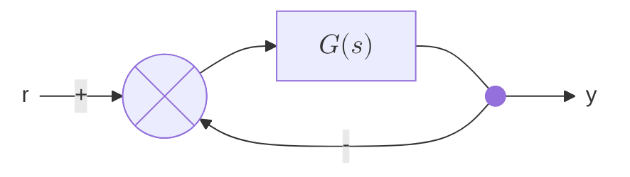

# Ephemeris plugins

Plugins for [Ephemeris](https://github.com/Gativrek/ephemeris-notes), the desktop note app for plain Markdown notes. Each plugin lives in `plugins/<id>/` and builds into its own folder that the app installs.

| Plugin | Block | What it does |
|---|---|---|
| [Text to Image](plugins/text-to-image) | ` ```combo ` | Draws token notation, such as fighting-game combos, as images through data-only profiles. |
| [Control Plots](plugins/control-plots) | ` ```bode ` ` ```step ` ` ```pzmap ` | Bode, step and pole-zero plots from transfer functions, checked against MATLAB. |
| [Diagrams](plugins/diagrams) | ` ```mermaid ` | Mermaid flowcharts and control block diagrams, with a drag-and-drop canvas. |

Plugins use only the typed plugin API, `@ephemeris-notes/plugin-api`. They run in the app's renderer with no Node access. Plugins are trusted code: install only plugins you trust.

## Development

Requires Node.js and pnpm. The plugin API is linked from the Ephemeris repository, so check this repository out at `ephemeris-plugins/` inside an `ephemeris-notes` checkout.

```
pnpm install
pnpm build        # every plugin into plugins/<id>/dist/
pnpm test         # unit tests (Vitest)
pnpm typecheck
pnpm lint
```

To try a plugin, build it, then in Ephemeris open Settings > Plugins > Install from Folder… and pick `plugins/<id>/dist`. Reinstalling the same folder replaces the plugin.

## Text to Image

````
```combo numpad
5H > 2M > 236L
```
````

The profile comes from the word after `combo`, then the note's `combo-profile` property, then the default in the plugin's settings. Profiles are folders of JSON and images in the library (`.ephemeris/plugin-data/text-to-image/profiles/<id>/`), so they sync with the notes and are safe to share. The plugin ships one example profile, **Numpad**, with original glyphs (Settings > Plugins > Text to Image > Add Example Profile). It ships no game art; use images you have the right to use. The plugin's help page, in Settings > Help, documents the profile format.

## Control Plots

````
```bode
G = 10/(s(s+1)(s+5))
margins = on
```
````

To start one, type ` ```bo ` (or `st`, `pz`) and pick the block from the suggestions, write a line like `G = 1/(s+1)`, and leave the block. The help page, Settings > Help > Control Plots guide, walks through a first plot. Systems are `tf([num], [den])` or expressions in `s`, and may build on each other (`L = C*G`, `T = L/(1+L)`). The plugin's help page lists the options. The tests compare Bode magnitude and phase, step samples, poles, zeros and margins with MATLAB's Control System Toolbox on fourteen systems; `pnpm --filter @ephemeris-plugins/control-plots refs` regenerates the references in `plugins/control-plots/test/refs` (needs MATLAB), and the committed CSVs let the tests run without it.

Plot colours come from the design system's `viz-1` … `viz-6` tokens, with the same values built in for apps that predate them.

## Diagrams

````

````

Any Mermaid diagram renders, through Mermaid (11.17, loaded on first use from its own chunks, so a library without diagrams does not pay for it). A flowchart in the editable subset (rectangles, circles, diamonds, summing junctions, branch points, text labels, `-->` and `---` with labels, math labels in `$$…$$`) can be drawn on a canvas from the block's Edit button. The canvas saves node positions as `%% @pos ID x y` comments, and once every node has one, the plugin draws the diagram itself, with horizontal and vertical edges and feedback paths routed underneath. Other apps ignore the comments and lay out the same graph. The help page, Settings > Help > Mermaid quick tutorial, covers the syntax and the canvas.

## License

MIT. See [`LICENSE`](LICENSE).
