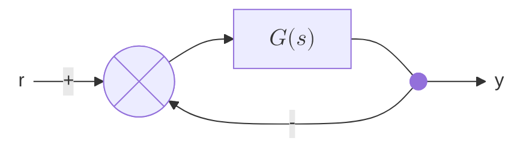

# Ephemeris plugins

Plugins for [Ephemeris](https://github.com/Gativrek/ephemeris-notes), the desktop note app for plain Markdown notes. Each plugin lives in `plugins/<id>/` and builds into its own folder that the app installs.

| Plugin | Block | What it does |
|---|---|---|
| [Text to Image](plugins/text-to-image) | ` ```combo ` | Draws token notation, such as fighting-game combos, as images through data-only profiles. |
| [Control Plots](plugins/control-plots) | ` ```bode ` ` ```step ` ` ```pzmap ` | Bode, step and pole-zero plots from transfer functions, checked against MATLAB. |
| [Diagrams](plugins/diagrams) | ` ```mermaid ` | Mermaid flowcharts and control block diagrams, with a drag-and-drop canvas. |
| [Data Plot](plugins/data-plot) | ` ```plot ` | Line, scatter and step plots of CSV files in the Vault, redrawn when the file changes. |
| [Citations](plugins/citations) | `[@key]` and ` ```bibliography ` | Pandoc citations from BibTeX or CSL-JSON, in IEEE or ABNT, with hover cards and a reference list. |
| [Flashcards](plugins/flashcards) | `front :: back` and `{{cloze}}` lines | Cards in notes with `flashcards: true`, scheduled with FSRS and reviewed on the desk. |
| [Tasks](plugins/tasks) | ` ```tasks ` and `due:` dates | Task items across notes, listed by due date and filtered by scope, tag or folder; tick them from the list. |
| [Clip](plugins/clip) | ` ```clip ` | A segment of a local video in a note, on repeat, with its start and end set from playback. |
| [Script timer](plugins/script-timer) | `script: true` | Narration time per heading in the outline, and the total at the end of the note. |
| [Kanban](plugins/kanban) | `kanban: true` | A note as a board: headings are columns, list items are cards; drag, add and tick them. |

Plugins use only the typed plugin API, `@ephemeris-notes/plugin-api`. They run in the app's renderer with no Node access. Plugins are trusted code: install only plugins you trust.

Tasks and Kanban share their inline Markdown renderer and due-date chips through `packages/inline`. Control Plots and Data Plot share their plot frame (scales, panels, legend, hover and its CSS) through `packages/chart`, a workspace package each of them bundles; it sets each plugin's own class prefix.

## Development

Requires Node.js and pnpm. The plugin API is linked from the Ephemeris repository, so check this repository out at `ephemeris-plugins/` inside an `ephemeris-notes` checkout.

```
pnpm install
pnpm build        # every plugin into plugins/<id>/dist/
pnpm test         # unit tests (Vitest)
pnpm typecheck
pnpm lint
pnpm test:e2e     # contract tests in a built Ephemeris (build the app in ../apps/desktop first)
```

To try a plugin, build it, then in Ephemeris open Settings > Plugins > Install from Folder… and pick `plugins/<id>/dist`. Reinstalling the same folder replaces the plugin.

## Text to Image

````
```combo numpad
5H > 2M > 236L
```
````

The profile comes from the word after `combo`, then the note's `combo-profile` property, then the default in the plugin's settings. Profiles are folders of JSON and images in the library (`.ephemeris/plugin-data/text-to-image/profiles/<id>/`), so they sync with the notes and are safe to share. The plugin ships one example profile, **Numpad**, with original glyphs (Settings > Plugins > Text to Image > Add Example Profile). It ships no game art; use images you have the right to use. The plugin's help page, in Settings > Help, documents the profile format.

## Control Plots

````
```bode
G = 10/(s(s+1)(s+5))
margins = on
```
````

To start one, type ` ```bo ` (or `st`, `pz`) and pick the block from the suggestions, write a line like `G = 1/(s+1)`, and leave the block. The help page, Settings > Help > Control Plots guide, walks through a first plot. Systems are `tf([num], [den])` or expressions in `s`, and may build on each other (`L = C*G`, `T = L/(1+L)`). The plugin's help page lists the options. The tests compare Bode magnitude and phase, step samples, poles, zeros and margins with MATLAB's Control System Toolbox on fourteen systems; `pnpm --filter @ephemeris-plugins/control-plots refs` regenerates the references in `plugins/control-plots/test/refs` (needs MATLAB), and the committed CSVs let the tests run without it.

Plot colours come from the design system's `viz-1` … `viz-6` tokens, with the same values built in for apps that predate them.

## Diagrams

````

````

Any Mermaid diagram renders, through Mermaid (11.17, loaded on first use from its own chunks, so a library without diagrams does not pay for it). A flowchart in the editable subset (rectangles, circles, diamonds, summing junctions, branch points, text labels, `-->` and `---` with labels, math labels in `$$…$$`) can be drawn on a canvas from the block's Edit button. The canvas saves node positions as `%% @pos ID x y` comments, and once every node has one, the plugin draws the diagram itself, with horizontal and vertical edges and feedback paths routed underneath. Other apps ignore the comments and lay out the same graph. The help page, Settings > Help > Mermaid quick tutorial, covers the syntax and the canvas.

## Data Plot

````
```plot
file: data/run3.csv
x: t
y: [roll, pitch, yaw]
xlabel: Time (s)
```
````

The file is relative to the note (or to the Vault root with a leading `/`); small tables can follow a `---` line in the block instead. The delimiter and decimal commas are detected, a header-less file (MATLAB `writematrix`) is read by column number, lines starting with `#` are comments (a NumPy `savetxt` header comment names the columns), and lines longer than 5,000 samples are thinned with LTTB for drawing while hover reads every sample. The help page lists the options.

## Citations

Write `[@groves2013, p. 45]` or `@groves2013` with keys from Zotero (Better BibTeX), choose the exported `.bib` or CSL-JSON file in Settings > Plugins > Citations, and put a `bibliography` block where the reference list goes, or let the list appear at the end of the note. IEEE numbers references in the order the note cites them, live as you type; ABNT is author and year. A note can add its own libraries with Pandoc's `bibliography:` frontmatter, and **Insert Citation…** searches the library and inserts the key at the cursor. Bracketed citations need Ephemeris 1.3 or later (the grammar change that stops `[@key]` from being read as a link); Insert Citation and the list at the end of notes need 1.4 or later (plugin API 1.3).

**Licenses.** Citations bundles [citeproc-js](https://github.com/Juris-M/citeproc-js) 2.4.63, unmodified, under the CPAL-1.0 (it is also offered under the AGPL-3.0); its license is in `dist/licenses/citeproc-js.txt`. The CSL styles and locales in `plugins/citations/csl/` are the Citation Style Language projects' own, under CC BY-SA 3.0. The rest of this repository is MIT.

## Flashcards

In a note with `flashcards: true` in its frontmatter, a line `front :: back` is a card, and a line with `{{hidden}}` parts is one card per part. **Review Due Cards (This Vault)** and **Review Cards in This Note** open the review on the desk: what is due per note and section, then each card, Space to see the answer, and 1-4 to grade. Scheduling is FSRS ([ts-fsrs](https://github.com/open-spaced-repetition/ts-fsrs) 5.4.2, MIT); the state lives in the Vault's `.vault/plugin-data/flashcards/state.json`, and the only change to a note is a block ID (`^fc-a1b2c3`) on a card's line at its first review. Needs Ephemeris 1.4 or later (plugin API 1.3).

## Tasks

Any task item (`- [ ] text`) in any note is a task; add `due:2026-11-14` for a due date, shown as a chip (the date, **Today** or **Overdue**). A `tasks` block lists tasks from across your notes: empty, the open tasks of this Vault; or with `key: value` lines: `scope` (vault, domain, all), `status`, `due` (overdue, today, week, none, before or after a date), `tag`, `path`, `sort`, `group` and `limit`. Ticking a task in the list writes `[x]` into its note, checking first that the task is still there; clicking its note's name opens the note at the task. **Show Open Tasks (This Vault)** and **(All Vaults)** open the list on the desk with filters as controls. Needs Ephemeris 1.5 or later (plugin API 1.4).

## Clip

A `clip` block plays part of a video from the library: `file:` (a `[[link]]` or a path), `start:` and `end:` (`83.5`, `1:23.5` or `1:02:03`), `loop:` (on by default) and `muted:`. Playback stays inside the segment, and **Set Start** and **Set End** write the current playback time into the block, so a segment is chosen by scrubbing. Ephemeris plays MP4 (H.264) and WebM. Needs Ephemeris 1.0 or later (plugin API 1.0).

## Script timer

In a note with `script: true` in its frontmatter, each heading in the outline shows how long its section takes to read aloud, and the end of the note shows the total ("Script: 1,234 words · 8:14 at 150 wpm"). The speaking rate is a setting (150 words per minute) or the note's own `wpm:`. Headings, code, math, tables, comments and block quotes, which hold directions, are not counted. Needs Ephemeris 1.4 or later (plugin API 1.3).

## Kanban

A note with `kanban: true` in its frontmatter is a board: its headings are columns and the list items under them are cards, with any indented lines belonging to the card. **Open as Board** (a command, and a button at the end of the note) opens the board on the desk beside the note. Drag cards, or move the focused one with Alt+Arrow keys; add cards at a column's foot; tick them by their box. Each change edits the note itself, moving the card's own lines and nothing else, and the board follows edits made in the note. Columns and card text are edited in the note: clicking a card opens it at its line. Boards from Obsidian's Kanban plugin open too. Needs Ephemeris 1.5 or later (plugin API 1.4).

## License

MIT. See [`LICENSE`](LICENSE).

A built plugin that bundles other packages (Diagrams with Mermaid and KaTeX, Citations, Flashcards) carries their licenses in `dist/licenses/THIRD-PARTY.txt`, which the build writes from the list of packages in the bundle.
